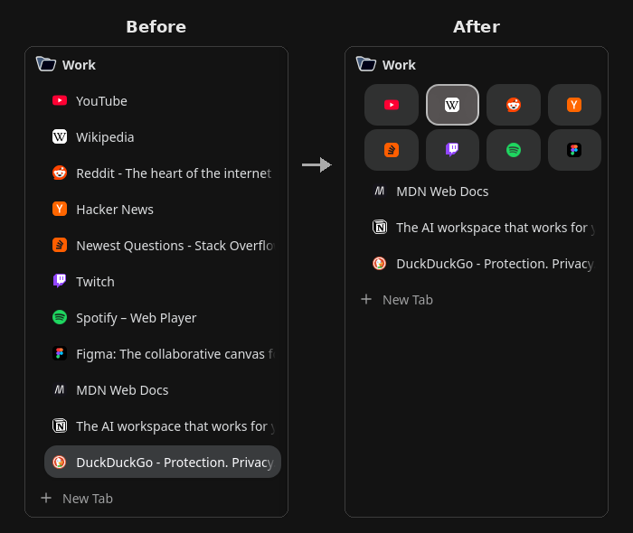

# Zen Folder Grid

A [Zen Browser](https://zen-browser.app) script. It shows chosen tabs of a folder
as an icon grid at the top of the folder, like Essentials. The normal tabs of
the folder stay below the grid.



- Right-click a tab in a folder: **Show as Icon** / **Show as Tab**.
- The icons look and act like Essentials tiles.
- Drag a tab onto the grid to add it. Drag inside the grid to change the order;
  the tiles move aside as on Essentials. Drag an icon out of the grid to make it
  a normal tab again.
- In a folder without icons, a drop area shows under the folder name when you
  drag a tab over the name. Drop the tab there to make the first icon.
- The marks stay after a restart. The script never closes or removes a tab.

Tested on Zen 1.23b, with fx-autoconfig and with Sine 2.3.3.

## Install

Choose one way. Sine and fx-autoconfig both use `<profile>/chrome/utils/`, so
use only one of them. Close Zen before you install.

### Linux: install script

```sh
curl -fsSL https://raw.githubusercontent.com/mahirsn/zen-folder-grid/main/install.sh -o install.sh
bash install.sh
```

The script finds Zen and its profiles, installs
[fx-autoconfig](https://github.com/MrOtherGuy/fx-autoconfig) and the mod, and
asks for sudo when the Zen folder is not yours. If it does not find Zen, give
the folder: `bash install.sh /path/to/zen`. Flatpak and AppImage installs are
not supported.

### Windows 10 or later: install script

1. Download the [ZIP of this repository](https://github.com/mahirsn/zen-folder-grid/archive/refs/heads/main.zip) and extract it.
2. Right-click `install.bat` and choose "Run as administrator".

The script does the same steps as the Linux script. It is tested only with
Wine, not on a real Windows yet.

Both scripts keep a `.bak` copy of each file they replace, and they stop if the
profile uses Sine.

### Sine

1. Install [Sine](https://github.com/CosmoCreeper/Sine).
2. In Sine settings, turn on "Enable installing JS from unofficial sources"
   (`sine.allow-unsafe-js`). Sine runs the JS of a mod that is not in its store
   only with this setting.
3. In Sine settings, add the mod `mahirsn/zen-folder-grid`.
4. Restart Zen.

### By hand

1. Copy `program/config.js` and `program/defaults/` of fx-autoconfig into the
   Zen install folder (for example `/opt/zen-browser-bin`).
2. Copy `profile/chrome/utils/` of fx-autoconfig into `<profile>/chrome/utils/`.
3. Copy `folder-grid.uc.mjs` into `<profile>/chrome/JS/`.
4. Restart Zen.

If the mod does not load after an install, open `about:support`, click "Clear
startup cache", and restart Zen.

## License

MPL-2.0. The tile style and the drag logic follow Zen's Essentials code.
